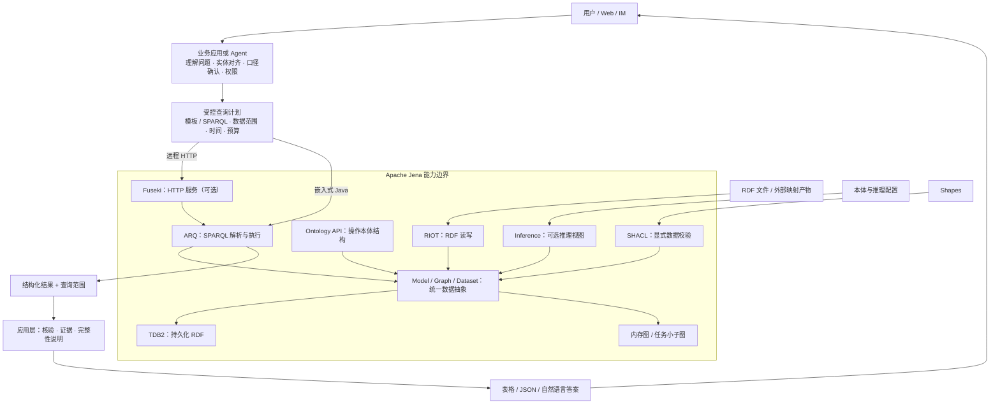
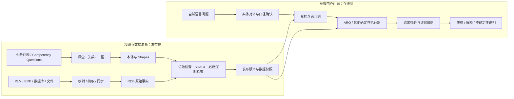
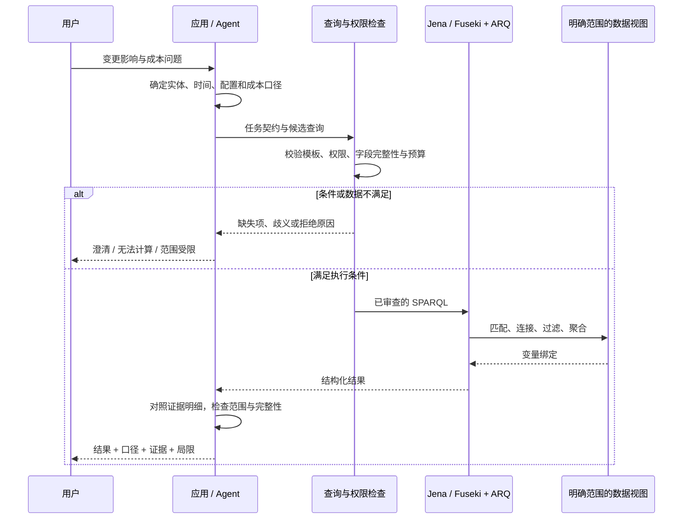
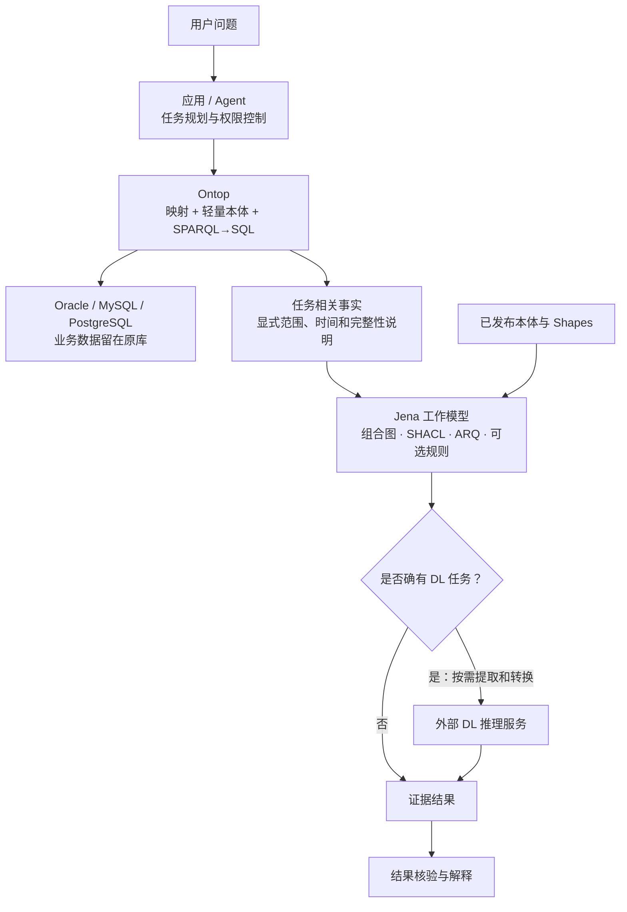

# Apache Jena 介绍与实践指南

## 从概念、历史与组件，到“真实问题 → 可核验结果”

**资料核对日期：2026-10-15**  
**版本基线：Apache Jena 6.2.0；Jena 6 要求 Java 21 或更高版本。**[S03][S04]  
**贯穿场景：汽车研发中的零件变更、BOM 影响与单车材料成本变化。**  
**案例声明：本文零件、车型、变更单和金额均为自建教学数据，不代表真实企业业务记录。**

> Jena 是面向 RDF 数据与语义网应用的 Java 技术框架，不是能够直接听懂中文并保证答案正确的问答系统。它提供读写、建模、查询、推理、校验、存储与服务化能力；业务定义、自然语言理解、权限和结果验收仍需要应用层负责。[S01][S02]

---

## 阅读导航

| 你想解决的问题 | 重点章节 |
|---|---|
| Jena 到底是什么，为什么出现？ | 1—2：定位与历史 |
| RDF、OWL、Model、Dataset 是什么关系？ | 3—4：标准与概念 |
| ARQ、TDB2、Fuseki 等组件怎么协作？ | 5—6：架构与组件 |
| 推理与校验有什么区别，能力到哪里？ | 7—8：推理与 SHACL |
| 中文问题怎样成为可核验的结果？ | 9—12：双流程、问题转换与案例 |
| 如何接入现有数据库、Ontop 和 Agent？ | 13—15：部署、生态与应用 |
| 如何避免错误并逐步落地？ | 16—18：工程治理、误区与学习路径 |

文中 `[Sxx]` 对应末尾的官方资料。架构图采用可编辑的 Mermaid 语法；不支持 Mermaid 的阅读器会显示图的源码，正文仍可独立阅读。

---

## 1. Jena 是什么：先建立正确定位

### 1.1 一句话定义

**Apache Jena 是用于构建语义网与关联数据应用的开源 Java 框架。** 它围绕 RDF 图组织数据，围绕 SPARQL 提供查询，并可组合本体、推理、校验和持久化能力。[S01]

在本文的研发场景中，可把它放在这个位置：

```text
业务系统中的数据
    ↓ 映射、抽取、同步：需要另行实现或接入
结构化的 RDF 事实与本体
    ↓ Jena 负责处理、查询、按配置推理/校验
可核验的结果与证据
    ↓ 应用或大模型负责解释和展示
用户看到的答案
```

### 1.2 它是框架，不只是一个数据库

把几个经常混用的名称分开看：[S05]

| 名称 | 主要角色 | 可以类比，但不能等同于 |
|---|---|---|
| Apache Jena | 整套 RDF 应用框架 | 一套数据处理技术栈 |
| ARQ | SPARQL 查询引擎 | 查询解析器与执行引擎 |
| TDB2 | 本地持久化 RDF 存储 | 嵌入式图数据存储引擎 |
| Fuseki | SPARQL HTTP 服务器 | 把查询和数据访问能力服务化的服务器 |
| Ontology API | 操作本体结构的 Java API | 面向类、属性、限制等对象的编程接口 |
| Inference API | 组合和调用推理器 | 对图增加语义推导能力的接口 |

因此，“用了 Jena”可能只是一个 Java 程序读写几十条 RDF，也可能是一个由 Fuseki、TDB2、ARQ 和应用服务组成的生产系统。

### 1.3 它不自动完成哪些事？

下表是本文采用的**工程职责划分**，不应把应用工作错误归给数据引擎。

| 工作 | 应由谁承担 |
|---|---|
| 理解“最新”“有效”“影响”“成本”的业务含义 | 业务规则、语义目录与应用层 |
| 将自然语言转为实体、参数、查询计划 | 模板、解析器或 LLM/Agent |
| 把 Oracle/MySQL 表转换成 RDF | 映射/ETL/VKG 组件 |
| 确认成本币种、税口径、时间和版本 | 业务契约与数据质量规则 |
| 执行结构化查询 | ARQ 或其他相应查询后端 |
| 给出用户可读解释 | 应用或受证据约束的 LLM |
| 审批变更、修改 PLM 或 ERP | 业务 Action 服务，而非 OWL 公理本身 |

**定位原则：Jena 让数据处理更明确、更可编程，不会替你定义业务事实。**

---

## 2. 历史：从研究工具到 Apache 技术框架

### 2.1 关键时间线

| 时间 | 事件 | 对今天理解 Jena 的意义 |
|---|---|---|
| 2000 年 | HP Labs 在英国布里斯托开始开发 Jena | 起点是语义网研究和应用开发，而不是 LLM 问答产品 |
| 2009 年 | HP 调整直接支持 Jena 开发的活动 | 项目后续转向 Apache 社区治理 |
| 2010 年 11 月 | 项目进入 Apache 孵化器 | 成为 Apache 项目孵化的一部分 |
| 2012 年 4 月 | 毕业成为 Apache 顶级项目 | 形成长期社区维护的项目身份 |
| 2020 年 12 月 | SDB 生命周期终止；最后随 Jena 3.17.0 发布 | 不应照搬早期“Jena + SDB + MySQL”方案 |
| 2024 年 7 月 18 日 | Jena 5.1.0 引入 `jena-ontapi` | 新旧本体 API 的教程需要区分 |
| 2026 年 2 月 4 日 | Jena 6.0.0 发布，最低 Java 21；退役旧 WAR 等模块 | 升级涉及运行时、API 和部署方式，不只是改版本号 |
| 2026 年 7 月 31 日 | Jena 6.2.0 发布 | 本文核对时官方下载页列出的版本 |

前四项来自项目历史；其余来自官方退役说明、安全公告及发布记录。[S02][S04][S06][S07]

### 2.2 如何理解这段演进

从这些变化可以看出：**Jena 的核心是一套可组合的 RDF 技术基础，围绕它持续演进查询、存储、服务与 API。** 这是对项目历史和模块结构的归纳，不意味着所有旧模块都会永久保留。

对使用者而言，最重要的不是背诵版本，而是识别旧资料中的几个信号：

| 旧教程中的内容 | 新项目应如何处理 |
|---|---|
| `com.hp.hpl.jena...` | 识别为很早期 API，不能直接复制到现代项目 |
| SDB、`jena-sdb` | 已退役，不能视作当前推荐持久化方案 |
| TDB / TDB1 | 与 TDB2 分开识别；Jena 6 已弃用 TDB1，但并非全部立即移除 |
| `org.apache.jena.ontology` | 与新的 `org.apache.jena.ontapi` 区分，按目标版本核对 |
| Fuseki WAR、`jena-fuseki-webapp` | Jena 6 已退役相关打包模块 |
| `jena-permissions` | 已退役；不要与仍在文档中的 Fuseki 访问控制能力混淆 |

这些变化以发布记录和目标版本源码/API 为准。部分概览页仍可能保留旧打包方式的文字，不能据此推翻更新的版本说明。[S04][S06][S17][S29]

### 2.3 本文采用什么版本口径

本文以 **Jena 6.2.0 / Java 21+** 为资料基线。6.1.0 发布说明已描述 RDF 1.2 与 SPARQL 1.2 相关支持；教学例子仍采用 RDF 1.1 和 SPARQL 1.1 的基础语法，降低学习与互操作负担。这里不据软件发布说明推断 W3C 新规范的最终标准状态。[S03][S04]

---

## 3. 标准地图：Jena 与 RDF、OWL、SPARQL 的关系

这些名称不在同一个层次，不是互相替代的产品。

| 层次 | 名称 | 回答的问题 | 本文中的例子 |
|---|---|---|---|
| 数据模型 | RDF | 事实怎样表达？ | P100 是一个雷达支架 |
| 基础语义 | RDFS | 类与属性怎样形成层级？ | 雷达支架是零件的子类 |
| 本体语言 | OWL | 怎样表达更丰富的逻辑关系？ | 等价、互斥、限制、属性特征 |
| 序列化格式 | Turtle / RDF/XML / JSON-LD | 图怎样写成文件或传输？ | `ontology.ttl` |
| 查询语言 | SPARQL | 如何匹配、关联、过滤、聚合图数据？ | 查询受影响 BOM |
| 数据约束 | SHACL | 当前数据是否满足约定？ | 一个零件版本必须有一个单价 |
| 实现框架 | Jena | 这些能力怎样在程序中落地？ | 读文件、查询、推理、校验 |

标准定义与 Jena 的 I/O 支持分别见官方规范和实现文档。[S08][S09][S10][S11][S12]

### 3.1 一组数据，三种工作

```turtle
@prefix ex:   <https://example.org/vehicle/> .
@prefix rdfs: <http://www.w3.org/2000/01/rdf-schema#> .

ex:RadarBracket rdfs:subClassOf ex:Part .
ex:P100 a ex:RadarBracket .
```

**查询**：找到显式声明为 `RadarBracket` 的对象。  
**推理**：根据子类关系，得到 `P100` 也是 `Part`。  
**校验**：检查 P100 或其版本是否有业务要求的编号、价格等信息。

这三件事相关，但不能互相替代。尤其不能把“没有填价格”直接解释为“OWL 本体发生矛盾”。[S09][S10]

### 3.2 TTL 不是本体语言本身

Turtle 是 RDF 的一种写法。同一个 TTL 文件可以放本体公理、实例事实、SHACL 约束，甚至 Jena Assembler 配置。文件用途由内容和加载方式决定，而不是由 `.ttl` 后缀决定。[S11][S25]

---

## 4. 核心概念：从三元组到 Dataset

### 4.1 Triple：一个关系陈述

```text
主语 Subject       谓语 Predicate        宾语 Object
ex:P100            rdf:type             ex:RadarBracket
ex:P100_A          ex:revisionOf         ex:P100
ex:P100_A          ex:unitPrice          "100.00"^^xsd:decimal
```

本文使用 RDF 1.1 基础模型：主语为 IRI 或空白节点，谓语为 IRI，宾语为 IRI、空白节点或字面量。IRI 用于标识对象；字面量表示文本、数值、日期等值。[S08]

特别注意：**“前雷达支架”是标签，不应替代稳定标识。** 两个同名零件未必是同一个零件；同一零件可以有多个语言标签。本文示例用 `ex:P100` 作为主数据对象，用 `ex:P100_A` 表示其 A 版本。

### 4.2 Graph 与 Model：数据结构和面向应用的视图

| 概念 | 理解方式 | 常见 Java 接口 |
|---|---|---|
| RDF Graph | 一组 RDF 三元组 | `Graph` |
| Model | 面向应用开发的 RDF 图访问接口 | `Model` |
| Statement | Model API 中的一条语句 | `Statement` |
| Resource / Property / Literal | 资源、属性、字面量的 API 对象 | 同名接口 |

`Model` 不是机器学习模型，也不是单独一种数据库。它可以是内存图的访问接口，也可以建立在其他存储实现之上。RDF 图采用集合语义：重复加入完全相同的三元组，不会自动产生第二次业务用量。[S12]

例如，同一辆车安装两只相同零件，不应靠重复写两次 `BOM hasPart P100` 表示；应建两个装配位置，或记录数量。这是后文引入 `BOMLine` 的原因。

### 4.3 Dataset：默认图加若干命名图

Jena 的 `Dataset` 表示一个默认图和若干命名图的集合；查询可以明确指定访问哪一个图。[S13]

```text
Dataset
├── Default Graph
├── Named Graph: urn:ontology:vehicle:v1
├── Named Graph: urn:source:plm:snapshot-001
├── Named Graph: urn:source:erp:snapshot-001
├── Named Graph: urn:derived:release-001
└── Named Graph: urn:shapes:release-001
```

上面的图名是一种**建议的工程组织方式**，并非 Jena 强制目录。可用它分离定义、原始事实、推导事实与约束。

**默认图不天然等于全部命名图的并集。** 是否采用 union 视图取决于 Dataset 和查询配置；`GRAPH <...>`、默认图、合并图必须有明确约定。[S13][S14]

命名图也不是完整权限机制。把供应商数据放进一个名为“private”的图，不会自动让它私密；仍需访问控制。[S29]

### 4.4 OntModel 与 InfModel：不要混淆

| 对象 | 核心目的 | 不应推断出的结论 |
|---|---|---|
| `Model` | 操作一般 RDF 语句 | 不代表已启用推理 |
| `OntModel` | 便于操作类、属性、个体和限制等本体结构 | 不代表完整 OWL 2 DL 推理 |
| `InfModel` | 在基础图上提供推理视图，并提供推理相关操作 | 不代表所有推导都已永久写入数据库 |

本体 API 是对底层 RDF 结构的便利封装；推理能力取决于具体配置。新 Ontology API 自 Jena 5.1.0 引入，使用 `jena-ontapi`，新项目应查新文档。[S17][S19]

### 4.5 TBox 与 ABox：逻辑分工，不是强制存储格式

**TBox** 描述类、属性与公理，例如“雷达支架是一种零件”。  
**ABox** 描述具体对象，例如“P100 是雷达支架，P100_A 是它的 A 版本”。

Jena 并不要求它们分别存入特定文件或数据库。拆分通常是版本治理、性能和复用方面的工程选择；对推理器而言，关键是运行时究竟绑定了哪些定义和实例。[S18]

---

## 5. 总体架构：看清应用层与 Jena 的边界

下图是为本文案例设计的**参考架构**，不是每个项目必须完整安装的组件清单。



图中模块职责依据 Jena 官方文档；连接关系是可选组合方式。[S05][S15][S16][S20]

### 5.1 三个关键阅读方法

**横向看职责**：自然语言理解在应用侧，结构化执行在 Jena 侧。  
**纵向看数据**：文件经 RIOT 进入图；图可放内存，也可持久化。  
**不要把所有框理解成必经串行步骤**：没有推理需求就不启用推理；没有服务化需求就不启动 Fuseki。

特别是，**ARQ 查询基础 Dataset 时，不会因为系统里“存在一个 OWL 文件”就自动绕到推理器执行。** 查询必须明确指向启用了所需推理的模型/视图，或者查询已物化的推导数据。[S18][S19]

---

## 6. 组件地图：按职责理解，而不是记缩写

### 6.1 核心组件总览

| 组件 | 输入 → 输出 | 典型用途 | 主要模块或入口 |
|---|---|---|---|
| RDF API | 资源与语句操作 → RDF 图变化 | 创建、遍历、组合数据 | `jena-core`、`Model` |
| RIOT | Turtle 等序列化 → 图/流，或反向输出 | 文件导入、导出与格式转换 | `RDFDataMgr`、`RDFParser`；不是必须另装的 `jena-riot` 服务 |
| ARQ | SPARQL + 数据视图 → 查询结果 | 查询、聚合、更新、联邦查询 | `jena-arq` |
| TDB2 | 图读写 → 磁盘持久化与事务 | 本机 RDF 存储 | `jena-tdb2` |
| Fuseki | HTTP 请求 → SPARQL/图访问结果 | 对其他系统暴露服务 | `jena-fuseki-main` 等 |
| Ontology API | 本体对象操作 → 对应 RDF 结构 | 管理类、属性、限制、导入 | `jena-ontapi` |
| Inference | 基础图 + 规则/公理 → 推理视图 | 补充隐含关系 | `Reasoner`、`InfModel` |
| SHACL | 数据图 + Shapes → 校验报告 | 数据约束检查 | `jena-shacl` |
| RDFConnection | 本地/远程连接 → 统一操作接口 | 查询、更新和图访问 | `jena-rdfconnection` |
| Assembler | RDF 配置 → 模型/数据集等对象 | 声明式装配运行环境 | Assembler API 与配置词汇 |

表中职责来自对应官方组件文档；Maven 使用方式见依赖指南。[S11][S12][S15][S16][S17][S18][S20][S21][S25][S32]

### 6.2 ARQ：真正执行结构化查询的地方

最常见的结果形式如下：[S15][S28]

| 操作 | 结果 | 案例用途 |
|---|---|---|
| `SELECT` | 变量绑定形成的结果行 | BOM 编号、数量、成本增量 |
| `ASK` | 布尔值 | 当前图和查询条件下，是否有匹配事实 |
| `CONSTRUCT` | 根据模板构造的 RDF 图 | 为任务提取证据子图 |
| `DESCRIBE` | 资源描述图，具体内容受实现影响 | 探索对象，不宜当成固定业务接口契约 |
| SPARQL Update | 数据更新操作 | 插入、删除或修改 RDF 数据 |

`SELECT` 结果的每一行不是一段“LLM 看法”，而是一组满足查询模式的变量绑定。但查询若写错业务条件，执行成功仍然会得到错误业务答案。

### 6.3 TDB2：解决持久化，不包办业务语义

TDB2 是面向单机的 RDF 存储组件，支持 Jena API，并可与 Fuseki 组合。它要求事务使用，不应按无事务的“自动提交”模式理解；TDB1 与 TDB2 的存储并不兼容。[S16]

选择 TDB2 的含义是“将 RDF 图长期存到本机磁盘”，不是“业务库实时同步已解决”，也不是“自动获得分布式高可用”。跨系统同步与高可用仍应另行设计。

### 6.4 Fuseki：网络入口，不是自然语言入口

Fuseki 可独立运行或嵌入应用，提供 SPARQL 查询/更新协议及 Graph Store Protocol。非 Java 客户端可以通过 HTTP 使用这些协议，因此 Vue、Go、Python 或旧 Java 服务并不需要嵌入全部 Jena 库。[S20]

典型职责分配：

```text
业务 API：/changes/ECN-2026-017/impact
    ↓ 应用层：检查用户、参数与业务口径
SPARQL 端点：按服务配置确定地址
    ↓ Fuseki → ARQ → Dataset
结构化结果
```

业务 API 与 SPARQL 端点是不同抽象。面向普通用户时，优先暴露业务 API，而不是让任何客户端自由提交任意 SPARQL。

### 6.5 扩展组件：需要时再引入

| 能力 | 组件 | 使用边界 |
|---|---|---|
| 文本检索 | Jena Text / Lucene | 搜索标签或文字内容；不等于自动具备向量检索和语义理解 |
| 地理空间查询 | GeoSPARQL | 处理空间关系与地理对象；不是一般 BOM 查询必需项 |
| 另一类图形状校验 | ShEx | 与 SHACL 的职责接近，但不是相同语言或相同接口 |
| 记录 RDF 变化 | RDF Patch | 表达增删等图变化；不等于自动完成 Oracle/MySQL 的 CDC |

按实际查询需求引入扩展，避免把全部模块都放进最小应用。[S22][S23][S24][S26]

---

## 7. 推理：Jena 能推出什么，不能承诺什么

### 7.1 本体、推理器、推导事实是三个对象

以此前的两条三元组为例：

```text
本体定义：RadarBracket 是 Part 的子类
原始事实：P100 是 RadarBracket
推理结果：P100 是 Part
```

本体负责表达关系，推理器负责实现相应语义。只是读取文件，和以支持该规则的推理视图查询，不是同一件事。[S09][S18]

### 7.2 内置推理器的能力边界

| 类型 | 适合的任务 | 关键边界 |
|---|---|---|
| 层级传递推理器 | 类、属性层级遍历 | 不应误认为处理任意业务属性全部 OWL 特征 |
| RDFS 推理器 | 子类、子属性、domain/range 等 RDFS 蕴含 | 取决于所选配置与支持范围 |
| OWL / OWL Mini / OWL Micro | 规则实现覆盖的部分 OWL 推导 | 官方明确说明这些实现并不完备 |
| GenericRuleReasoner | 自定义 RDF 规则 | 支持前向、带表后向和混合策略；不是任意 OWL DL 推理器 |

**不能把 Jena 的 OWL 规则推理直接表述为完整 OWL 2 DL 推理。** 规则数量、支持某些 OWL 词汇，或配置名包含 `OWL2_DL`，都不能单独证明推理语义的完备性。[S18]

### 7.3 “建模 Profile”不等于“推理能力”

在本体 API 中选择某种语言规格，首先约束的是如何表示和操作本体对象。是否进行推理、使用哪种推理器，是另一个配置维度。尤其不要把 `OWL2_DL_MEM` 当成“完整 DL 推理已开启”。[S17]

对涉及复杂限制、互斥和一致性的任务，可以另行评估 HermiT 这类 OWL 2 DL 推理器；但需要处理 API、版本、语义转换和任务范围，不是把任意推理器名称填进一个框就自动集成。[S31]

### 7.4 推导数据放在哪里？

`InfModel` 是带推理能力的模型接口。基础图、推导视图及可取得的推导集合应区分；某些推导可能按需计算，不能假定 `getDeductionsModel()` 就枚举了所有逻辑后果。具体行为取决于推理器。[S19]

工程上通常在两种方案中选择：

| 方案 | 做法 | 需要承担的成本 |
|---|---|---|
| 查询时推理 | 查询推理视图 | 请求延迟、缓存、内存和计算预算 |
| 预计算/物化 | 把选定推导写入独立图 | 更新后的重算、过期结果清理与版本管理 |

这张表是工程取舍，不表示 Jena 默认替你建立了完整增量物化流水线。

### 7.5 多个 TTL 能否一起推理？

可以把多个文件的相关三元组加载到同一个工作模型，或明确组合成推理器可见的图。重点不是文件数量，而是**标识一致、依赖齐全、推理范围明确**。[S11][S18]

如果本体在命名图 A，实例在命名图 B，不能只凭“都属于一个 Dataset”便认定它们已经共同参与推理。应明确使用哪些图的组合，且必须先完成权限过滤。[S13][S14]

---

## 8. SHACL：校验当前数据，而不是推导隐藏事实

### 8.1 三种检查，各有不同问题

| 检查 | 问题 | 示例 |
|---|---|---|
| RDF 语法检查 | 文件能否被正确解析？ | Turtle 是否少了句号、IRI 是否非法 |
| SHACL 校验 | 指定数据图是否满足给定 Shapes？ | 单价是否存在、是否只有一个、是否为 decimal |
| 逻辑一致性检查 | 在指定语义下，公理和事实是否可以同时成立？ | 一个对象是否同时属于两个互斥类 |

Jena SHACL 实现 SHACL Core 和 SHACL SPARQL Constraints；推理器自己的验证接口不能替代 SHACL，也不应被泛化为完整 DL 一致性检查。[S10][S27][S19]

### 8.2 为什么“没有价格”不等于逻辑矛盾？

OWL 使用开放世界语义：未记录的信息可能只是未知。业务录入却可能规定“用于成本核算的每个版本，必须有且只有一个价格”。后一种要求应转化为显式数据约束，例如 `sh:minCount 1`、`sh:maxCount 1`。[S09][S10]

案例中的简化价格约束：

```turtle
ex:RevisionShape a sh:NodeShape ;
    sh:targetClass ex:PartRevision ;
    sh:property [
        sh:path ex:unitPrice ;
        sh:minCount 1 ;
        sh:maxCount 1 ;
        sh:datatype xsd:decimal ;
        sh:minInclusive 0
    ] .
```

**注意业务前提**：现实中可能允许多个供应商报价、不同币种和不同有效期。那就不应强制“零件版本只有一个单价”，而应建立价格记录实体，并把查询限定到某个价格上下文。本文的单价模型只是教学简化。

### 8.3 校验应放在什么位置？

推荐在发布前校验待发布图，在计算前检查关键字段与口径，在写入时校验提交后的候选状态。必要时可以分别校验原始图和推理视图，但应记录各自范围。

Fuseki 的 SHACL 操作需要显式配置，不是默认对所有写入开启的数据库约束。仅添加一个校验端点，也不代表所有其他更新路径都会自动拒绝违规数据。[S27]

---
## 9. 两条工作流：先准备知识，再处理用户请求

“用户提出问题 → 系统返回结果”只是在线部分。数据没有准备好时，在线查询再精巧也无法补齐事实。

### 9.1 参考双流程



这是本文建议的应用流程。Jena 在其中承担 RDF 读写、查询及所配置的校验/推理工作；映射、审批、同步和发布治理由外围系统落实。[S11][S15][S27]

### 9.2 从业务问题反向设计数据

例如先明确以下 Competency Questions，而不是先堆积类和属性：

| 业务问题 | 必需的语义对象 | 必需的数据约束 |
|---|---|---|
| 变更替换哪个版本？ | ChangeOrder、PartRevision | 旧版本、新版本、对象对应关系明确 |
| 哪些 BOM 受影响？ | BOM、BOMLine | 版本、配置、生效区间、发布状态明确 |
| 每款车增加多少材料成本？ | 用量、价格上下文 | 数量、币种、价格版本和计算单位一致 |
| 答案依据是什么？ | 来源标识、快照、查询版本 | 能回溯输入与筛选范围 |

这张表是案例设计的方法：**问题决定需要哪些概念、关系和事实；不是把所有现有表逐列照抄成“本体”就完成设计。**

### 9.3 发布侧建议保留的资产

```text
release-001/
├── ontology.ttl         # 定义
├── shapes.ttl           # 约束
├── mappings/            # 数据来源到语义对象的映射
├── queries/             # 已审查的查询模板
├── tests/               # 正常与异常测试
└── manifest.json        # 版本、数据快照、时间与兼容性信息
```

这是一种建议目录，不是 Jena 内置发布标准。它的作用是让本体、约束、映射和查询共同形成可回滚的版本，而不是只给 TTL 文件打版本号。

---

## 10. 一个真实类型的用户问题，怎样转换成结果？

### 10.1 原始问题

> “变更单 ECN-2026-017 把 P100 前雷达支架从 A 版改成 B 版，会影响哪些已发布且当前有效的整车 BOM？每款车的材料成本增加多少？”

这个问题自然，但“当前有效”“材料成本”“每款车”都需要业务解释。以下将它转换为一个可执行契约。

### 10.2 第一步：把模糊问题变成明确口径

| 维度 | 本例固定值或定义 |
|---|---|
| 变更单 | ECN-2026-017 |
| 变更对象 | P100 的 A 版本替换为 B 版本 |
| 查询时间 | 2026-10-15 09:00:00，UTC+08:00；作为教学快照时间 |
| BOM 状态 | 已发布 `Released` |
| 有效期 | `validFrom ≤ 查询时间 < validTo`，左闭右开 |
| 配置口径 | 按车型与配置分别列示 |
| 影响定义 | 使用旧版本的直接 BOM 行将被替换；不泛指所有工程影响 |
| 数量口径 | 每辆车的装配用量 |
| 成本口径 | 同币种、可比单价的材料成本差；不含税、物流、报废和模具摊销 |
| 计算公式 | Σ［装配用量 ×（新单价 − 旧单价）］ |

在真实系统中，未确定的关键条件应向用户确认，或采用已授权的默认口径并在答案中展示。不能让 LLM 默默猜测“最新”和“成本”。

### 10.3 第二步：实体对齐，得到稳定标识

```json
{
  "intent": "change_impact_and_unit_material_cost",
  "changeIri": "https://example.org/vehicle/ECN_2026_017",
  "oldRevisionIri": "https://example.org/vehicle/P100_A",
  "newRevisionIri": "https://example.org/vehicle/P100_B",
  "effectiveAt": "2026-10-15T09:00:00+08:00",
  "bomStatus": "Released",
  "scope": "direct_bom_lines",
  "costBasis": "comparable_material_unit_price"
}
```

这是**应用层输出的任务契约**，不是 Jena 从中文自动生成的内容。候选匹配可以来自主数据编号、别名检索和文本索引；只有确定了唯一实体，才进入计算。

### 10.4 第三步：把任务转换为受控查询

建议让应用选择一个已经审查的查询模板，再填入实体、时间和权限范围。复杂问题可生成候选查询，但必须先经过语法、词汇、图范围和代价检查。

Jena 提供参数化 SPARQL 字符串等辅助能力，但参数化不等于完整查询沙箱；官方文档也提醒它不能在所有情形下彻底防止注入。不能把用户文本直接拼进任意查询结构。[S34]

### 10.5 第四步：计算前先检查数据契约

必须先区分三个问题：

```text
是否存在受影响 BOM？
是否所有受影响项都具备足够计算数据？
这些数据是否处于同一个可比成本口径？
```

例如，缺少新版本价格时，含必选价格模式的查询可能返回空结果。**空结果不能直接被翻译为“没有受影响 BOM”。** 它也可能意味着必要计算数据缺失。这是本案例特意设置的失败测试。

### 10.6 第五步：执行、核验和解释



整个链路中，“解释是否流畅”不能取代“查询是否正确”和“输入是否完整”。

---

## 11. ARQ 内部流程：一条 SPARQL 怎样执行？

### 11.1 逻辑执行阶段

```text
SPARQL 字符串
    ↓ 解析
Query / 抽象语法树（AST）
    ↓ 代数生成
图模式、连接、过滤、投影、聚合等代数表达
    ↓ 构建执行过程与优化
改写表达、选择适当的匹配和执行策略
    ↓ 在目标 Dataset / Graph 上求值
变量绑定流
    ↓ 查询类型决定输出形式
ResultSet / Boolean / RDF Model
```

这是依据 ARQ 文档归纳的逻辑阶段。ARQ 允许存储后端参与执行与低层优化，不应把它理解成所有后端完全相同的固定物理流水线。[S33]

### 11.2 在案例中，每一步意味着什么？

| 查询动作 | 本例中的作用 |
|---|---|
| 匹配变更单 | 找到旧版本与新版本 |
| 连接零件版本 | 取得可比单价和币种 |
| 匹配 BOM 行 | 找到使用旧版本的装配位置 |
| 过滤 | 排除草稿、过期 BOM，以及不匹配的版本 |
| 聚合 | 对每个 BOM 的有效装配位置计算单车成本增量 |
| 排序 | 稳定展示结果，不依赖存储遍历顺序 |

**图里没有重复三元组，不代表结果行不会重复。** 当某个连接字段存在多个匹配值时，SPARQL 会产生多个解；因此成本查询需要关注连接基数。[S28]

例如，一个版本有两个单价，单个装配位置可能匹配出两行。事后随手加 `DISTINCT` 不一定能修正口径，正确做法是先确定合法价格记录和唯一匹配范围。

### 11.3 属性路径不是完整的多层 BOM 成本算法

`ex:contains+` 这类属性路径可以表达沿关系的可达性，但“能到达哪个零件”与“沿每条装配路径逐层乘用量后汇总多少成本”不是同一任务。[S28]

例如：

```text
整车 → 2 个总成 → 每个总成 3 个支架
总装配用量 = 2 × 3 = 6
```

若有重复使用、替代件、配置条件、返环和有效期，单独一个可达性查询不足以代表正确的展开结果。建议把“影响对象检索”和“带业务规则的数量展开/计价”分开设计。

---

## 12. 完整教学案例：变更影响与成本

### 12.1 为什么建模为零件、版本、BOM 行？

```text
Part：P100
  ├── PartRevision：P100_A，单价 100.00 CNY
  └── PartRevision：P100_B，单价 120.00 CNY

ChangeOrder：ECN-2026-017
  ├── fromRevision → P100_A
  └── toRevision   → P100_B

BOM_A：车型 V-A / STD
  └── Line_A1 → P100_A，数量 1

BOM_B：车型 V-B / PRO
  ├── Line_B1 → P100_A，数量 1
  └── Line_B2 → P100_A，数量 1
```

这些都是本文定义的业务实例。`Part`、`PartRevision`、`BOM`、`BOMLine` 等是类；`P100` 不是“零件这个类”，而是一个具体主数据对象。版本与装配行独立建模，可以避免把多个版本和多个装配位置揉成一条关系。

### 12.2 核心事实节选

```turtle
@prefix ex:   <https://example.org/vehicle/> .
@prefix xsd:  <http://www.w3.org/2001/XMLSchema#> .

ex:P100 a ex:RadarBracket .

ex:P100_A a ex:PartRevision ;
    ex:revisionOf ex:P100 ;
    ex:unitPrice "100.00"^^xsd:decimal ;
    ex:currency "CNY" .

ex:P100_B a ex:PartRevision ;
    ex:revisionOf ex:P100 ;
    ex:unitPrice "120.00"^^xsd:decimal ;
    ex:currency "CNY" .

ex:ECN_2026_017 a ex:ChangeOrder ;
    ex:fromRevision ex:P100_A ;
    ex:toRevision ex:P100_B .

ex:Line_A1 a ex:BOMLine ;
    ex:usesRevision ex:P100_A ;
    ex:quantity "1.0"^^xsd:decimal .
```

完整文件在随附案例目录中，还包含 BOM 的状态、生效时间、配置，以及草稿、过期、已使用新版本的反例。

### 12.3 受控 SPARQL 查询

本例把数据作为单个查询图使用，避免让命名图配置干扰第一次学习。生产系统则应显式指定快照和授权图范围。

**前提：`shapes.ttl` 的校验与业务口径检查已经通过。** 若直接绕过前置检查，缺价或多价可能导致错误结果。

```sparql
PREFIX ex:  <https://example.org/vehicle/>
PREFIX xsd: <http://www.w3.org/2001/XMLSchema#>

SELECT ?bom ?vehicleModel ?configuration ?currency
       (SUM(?quantity) AS ?affectedQuantity)
       (SUM(?quantity * (?newPrice - ?oldPrice)) AS ?deltaPerVehicle)
WHERE {
  VALUES (?change ?at) {
    (ex:ECN_2026_017 "2026-10-15T09:00:00+08:00"^^xsd:dateTime)
  }
  ?change a ex:ChangeOrder ; ex:fromRevision ?old ; ex:toRevision ?new .
  ?old ex:revisionOf ?part ; ex:unitPrice ?oldPrice ; ex:currency ?currency .
  ?new ex:revisionOf ?part ; ex:unitPrice ?newPrice ; ex:currency ?currency .
  ?bom a ex:BOM ; ex:vehicleModel ?vehicleModel ; ex:configuration ?configuration ;
       ex:status ex:Released ; ex:validFrom ?start ; ex:validTo ?end ; ex:hasLine ?line .
  ?line a ex:BOMLine ; ex:usesRevision ?old ; ex:quantity ?quantity .
  FILTER(?start <= ?at && ?at < ?end)
}
GROUP BY ?bom ?vehicleModel ?configuration ?currency
ORDER BY ?vehicleModel ?configuration
```

这里的算术、过滤和聚合由查询执行器处理，不由 LLM 心算。案例中采用 decimal，并使用明确可比的币种；并未实现汇率转换或完整成本会计。

### 12.4 预期结果与解释

| BOM | 车型 | 配置 | 旧版本单车用量 | 单价变化 | 单车材料成本增量 |
|---|---|---|---:|---:|---:|
| BOM_A | V-A | STD | 1 | 120 − 100 = 20 CNY | 20 CNY |
| BOM_B | V-B | PRO | 2 | 120 − 100 = 20 CNY | 40 CNY |

对用户的合理表述是：

> 在指定教学快照时间和直接 BOM 行范围内，发现 2 个已发布且有效的 BOM 使用 P100 的 A 版本。替换为 B 版本后，V-A / STD 单车材料成本增加 20 元，V-B / PRO 增加 40 元。结果不包含物流、税、报废、模具摊销或多层 BOM 展开；已排除草稿、过期和已使用 B 版本的 BOM。

不能把两款车的“单车增量”直接加成“项目增加 60 元”。计算项目总影响还需要各车型产量与其他明确口径。

### 12.5 证据明细不能被聚合吞掉

建议同时保存：变更单 IRI、旧/新版本 IRI、BOM IRI、BOM 行 IRI、数量、价格、币种、查询时间、数据快照及查询模板版本。

本例 `evidence.rq` 返回 3 个装配行：A1、B1、B2。BOM_B 虽然只有一个零件版本，却有两个真实装配位置，因此其合计用量为 2，而不是去重后误算为 1。

### 12.6 本体在这个案例里真正起什么作用？

上述成本查询直接匹配已明确的业务关系，**不需要为了“使用本体”而强行加入 OWL 推理**。

本体先提供词汇、对象边界与关系定义。只有当查询需要“所有零件，包括各种子类实例”时，子类推理才显出差别：

```sparql
# 对普通图：没有显式 Part 类型时，可能没有结果。
PREFIX ex: <https://example.org/vehicle/>
SELECT ?part WHERE { ?part a ex:Part }
```

本例原始数据仅声明 P100 是 RadarBracket。可选择启用相关 RDFS 推理，或者在这个限定场景中显式沿已声明的子类路径查询：

```sparql
PREFIX ex:   <https://example.org/vehicle/>
PREFIX rdfs: <http://www.w3.org/2000/01/rdf-schema#>
SELECT DISTINCT ?part
WHERE { ?part a ?class . ?class rdfs:subClassOf* ex:Part }
```

后一种写法只是在查询中处理这一类层级关系，不等于实现了完整 RDFS 或 OWL 推理。[S18][S28]

### 12.7 Java 中最小的组件协作

以下是**接口使用示例**，用于说明读入、校验和查询之间的关系，不是完整生产服务。它不包含自然语言处理、身份权限、数据同步或发布系统；本次未在 Jena 运行时中编译执行。

```java
import java.io.IOException;
import java.nio.charset.StandardCharsets;
import java.nio.file.Files;
import java.nio.file.Path;
import java.util.concurrent.TimeUnit;
import org.apache.jena.query.QueryExecution;
import org.apache.jena.query.ResultSetFormatter;
import org.apache.jena.rdf.model.Model;
import org.apache.jena.riot.RDFDataMgr;
import org.apache.jena.shacl.Shapes;
import org.apache.jena.shacl.ShaclValidator;
import org.apache.jena.shacl.ValidationReport;

public final class Demo {
    public static void main(String[] args) throws IOException {
        Model data = RDFDataMgr.loadModel("data.ttl");
        Model shapeModel = RDFDataMgr.loadModel("shapes.ttl");
        try {
            RDFDataMgr.read(data, "ontology.ttl");
            Shapes shapes = Shapes.parse(shapeModel.getGraph());
            ValidationReport report = ShaclValidator.get()
                    .validate(shapes, data.getGraph());
            if (!report.conforms()) {
                throw new IllegalStateException(
                        "Data validation failed; stop before calculating costs.");
            }
            String sparql = Files.readString(
                    Path.of("impact.rq"), StandardCharsets.UTF_8);
            try (QueryExecution execution = QueryExecution.model(data)
                    .query(sparql).timeout(10, TimeUnit.SECONDS).build()) {
                ResultSetFormatter.out(System.out, execution.execSelect());
            }
        } finally {
            shapeModel.close();
            data.close();
        }
    }
}
```

关键 API 的依据是 Jena SHACL 示例、I/O 文档和 QueryExecution API。查询结果在执行对象关闭前被消费，避免把仍依赖活动执行器的结果迭代器带出作用域。[S11][S27][S39]

### 12.8 样例验证范围

随附文件已进行 **15 项 RDFLib 独立检查**，包括 Turtle 解析、SPARQL 结果、证据行、草稿排除、有效期边界、版本筛选、币种冲突、缺价和多价反例；检查结果全部通过。

**这些检查不是 Apache Jena 集成测试。** 当前环境无法下载 Jena 分发包，因此未运行 Jena 6.2.0、未执行完整 Jena SHACL Core 校验、未编译 Java 片段，也未验证 Fuseki/TDB2 部署。检查器仅执行了 Shapes 中的一个 SPARQL 约束查询，并没有冒充完整 SHACL 引擎。详细记录见 `verification/`。

---
## 13. 三种部署方式：按系统边界选择

### 13.1 嵌入式 Java：最少组件

```text
一个 Java 应用
  ├── 业务逻辑
  ├── Jena API / ARQ
  ├── 可选推理与 SHACL
  └── 内存 Model 或 TDB2
```

适合学习、小型服务和紧密集成的 Java 应用。无须为了使用 SPARQL 就额外启动 Fuseki。代价是 Jena 与应用共享 JVM、内存和依赖生命周期。[S12][S16]

### 13.2 独立 Fuseki：跨语言共享语义数据

```text
Vue / Go / Python / Java 应用
               ↓ HTTP
           Fuseki + ARQ
               ↓
        Dataset / 可选 TDB2
```

适合多个应用共用查询服务。Fuseki 管服务端数据访问，业务应用管业务 API、身份映射、交互和结果解释。[S20]

对于仍在运行 Java 8 或 Java 11 的已有业务系统，**可以优先评估独立 Jena 6/Fuseki 服务 + HTTP 集成**，避免把要求 Java 21 的库直接塞入旧 JVM。是否升级原业务服务则独立评估，而不是为了迁就旧运行时直接选择已退役模块。[S03]

### 13.3 混合架构：大数据留在业务库，小上下文交给 Jena



这是一种适合现有关系数据库的**参考设计**。Ontop 的角色是把关系库暴露为虚拟知识图谱并改写查询；Jena 处理任务相关图；外部 DL 推理不是每个问题的必经步骤。[S30][S31]

需要警惕两点：一是抽取小子图不天然保持全库推理的完备性；二是多个数据源的“最新”也不天然构成同一个一致性快照。两者都需要在任务契约里说明。

---

## 14. 与其他工具的关系：组合，而不是简单替代

| 工具/技术 | 主要职责 | 与 Jena 的关系 |
|---|---|---|
| Protégé / WebProtégé | 本体编辑与管理 | 常作为定义侧工具；不是 Jena 的存储或查询引擎 |
| Ontop | R2RML/映射驱动的 VKG、SPARQL→SQL | 可作为大规模关系数据的查询后端 |
| HermiT | OWL 2 DL 推理 | 可承担 Jena 内置规则推理不能完整覆盖的逻辑任务 |
| OWL API | 在 OWL 公理层操作本体、对接推理器 | 与 Jena 的 RDF 图视角不同；与 HermiT 集成时需核对版本 |
| SQL 数据库 | 业务事务与关系数据存储 | 不因引入 Jena 就必须被替换 |
| LLM / Agent | 理解问题、规划工具调用与解释 | 消费查询与证据，不替代事实执行引擎 |

前三项与 OWL API 的集成背景见各项目资料；后两项是本文的应用职责设计。[S30][S31][S37]

### 14.1 Jena 能否代替 Ontop？

不应把两者视为同一产品。Jena 的图 API 可以扩展数据源，但“提供图访问接口”并不等于已经完成 R2RML 映射、OWL 2 QL 查询重写和 SQL 优化。需要 VKG 时，优先评估专门承担这些职责的 Ontop。[S30][S33]

### 14.2 Jena 能否代替 HermiT？

取决于任务，而不是名字。如果只需要已支持的子类推导或简单规则，不必引入复杂推理器；如果需要完整 OWL 2 DL 语义，应按所用本体和具体推理任务评估 HermiT 等工具。**不能用“结果看起来合理”代替语义能力验证。**[S18][S31]

### 14.3 小子图是否一定足够？

不一定。这可以直接从逻辑依赖推导出来：如果支持结论的某条关系或公理被裁掉，局部推理器自然无法使用它；如果裁掉的是导致矛盾的事实，局部模型也可能看起来一致。

因此，建议给每次上下文抽取附加：实体范围、图范围、关系类型、跳数/路径规则、行数与三元组上限、时间范围、截断标记，以及该切片支持哪些查询的完整回答。**“1-hop/2-hop”只是范围策略，不是逻辑完备性证明。**

---

## 15. Jena 与 Agent：怎样提高答案可信度？

以下是本文建议的工程控制机制，并非 Jena 内置的完整 Agent 产品。

### 15.1 最小职责划分

```text
LLM：理解用户在问什么，提出候选执行计划
Ontology：明确对象、关系和语义口径
应用层：决定是否允许执行，以及查询哪些数据
Jena / SQL / 专用算法：完成确定性检索与计算
Verifier：检查结果、证据与范围
LLM：基于已核验结果解释，不另造数字或事实
```

### 15.2 “准确结果”至少需要六个条件

| 条件 | 应验证什么 | 失败时的处理 |
|---|---|---|
| 问题理解准确 | 是单车成本，还是项目总成本？ | 澄清或展示默认口径 |
| 实体对齐准确 | 是 P100_A，还是同名其他版本？ | 返回候选，不猜测 |
| 数据范围正确 | 时间、状态、配置与权限是否匹配？ | 限定范围或拒绝越权 |
| 查询与计算正确 | 连接是否重复、缺值是否被忽略？ | 停止计算或标注缺失 |
| 结果可核验 | 能否回到原始 BOM 行与价格记录？ | 不给无证据的确定结论 |
| 完整性有说明 | 是否分页、截断、超时或只取局部图？ | 返回部分结果状态 |

### 15.3 不要只有“成功/失败”两种状态

建议应用层区分：

| 建议状态 | 含义 |
|---|---|
| `COMPLETE` | 在已定义且已核验的数据范围内完整返回 |
| `PARTIAL` | 部分数据成功，存在明确缺失或截断 |
| `NEEDS_CLARIFICATION` | 实体或业务口径有歧义 |
| `NOT_COMPUTABLE` | 缺价、币种不可比、用量缺失等导致无法计算 |
| `DENIED` | 请求超出权限 |
| `TIMEOUT` | 没有在预算内完成，不等于无结果 |

这些是建议的业务状态名，不是 Jena 自带状态枚举。`COMPLETE` 也只能相对于已声明的数据覆盖范围，不能冒称覆盖现实世界全部事实。

### 15.4 权限与注入防护

身份和数据访问控制应在执行之前落实。Fuseki 提供服务/数据访问控制相关能力，但命名图隔离、受限数据集、端点权限、更新权限和应用层身份传播仍需要配置与测试。官方文档中的图级访问控制目前仅适用于只读数据集，不能直接外推为所有写操作的细粒度授权。[S29][S40]

建议采用固定查询模板或受限查询生成；校验语法树与允许的图/属性；不让 LLM 自由决定远程 `SERVICE`、加载地址或更新操作；限制外连、超时、结果量和路径扩张。参数化工具只解决其中一部分问题。[S34]

此外，若先在包含未授权数据的全图上推理，再仅过滤表面结果，可能泄漏隐含信息。推荐把**推理范围也纳入权限模型**，而不仅过滤最终展示的字段。这是面向语义系统的威胁建模建议。

### 15.5 Action 与查询必须分开

“查询这个变更影响谁”和“批准并实施这个变更”属于不同风险级别。建议采用独立只读与写入工具、明确参数、审批、幂等和审计；OWL 公理和 SPARQL 查询结果不能自行成为业务写操作的授权。

---

## 16. 生产工程：数据正确之后，还要能稳定运行

### 16.1 事务与一致性

Jena 提供统一事务 API，TDB2 的使用应遵循其事务要求。应让校验和正式查询针对同一份已发布快照，或在适当事务边界内处理，否则会出现“刚校验的数据”和“实际计算的数据”不是同一版的问题。[S16][S35]

特别注意：通过 HTTP 先发一个校验请求、再发一个查询请求，不意味着它们天然共享跨请求事务。跨数据源更不能假设存在自动分布式一致性；应使用业务快照、版本绑定或明确的新鲜度策略。SPARQL 并未定义跨请求的远程事务标准协议。[S21]

### 16.2 性能：先定位瓶颈，再换引擎

建议把一次响应拆开测量：

```text
总耗时 = 问题理解 + 实体检索 + 数据访问 + 可选推理
       + 查询/计算 + 核验 + 文本生成
```

这是测量分解方法，不是固定串行公式。部分步骤可并行，但仍应独立记录。

| 可能瓶颈 | 优先检查 |
|---|---|
| 查询太慢 | 过滤是否足够早、是否大范围路径查询、连接基数是否暴涨 |
| 推理太慢 | 是否全图推理、是否重复推理、本体和实例范围是否过大 |
| 内存太高 | 是否把全量数据装入 Model、缓存是否失控、结果是否全量收集 |
| 远程查询慢 | 请求次数、远程端点能力、网络与数据下推情况 |
| 成本计算错 | 数量单位、报价唯一性、装配位置重复、配置或有效期交叉 |

ARQ 的执行机制与存储后端可以影响优化策略；不存在不看数据和查询形态就成立的统一性能数字。[S33]

### 16.3 更新、备份与恢复

RDF 的变化可通过补丁等形式表达；TDB2 提供备份和压缩等管理能力。但数据同步、删除传播、物化推导失效与恢复演练仍属于系统工程。[S26][S36]

建议特别测试：旧报价撤销、零件版本停用、变更单撤回、源数据删除、同步中断，以及更新后推导图是否残留旧结论。

### 16.4 版本升级不是覆盖目录

升级前应锁定版本并保留数据备份，阅读目标版本迁移说明，再验证数值、查询、推理和索引行为。Jena 6 的发布说明包含数据重载等迁移提示，尤其不能对包含数值和地理索引的已有库假设“换几个 jar 即可”。[S04]

依赖应使用一致的 Jena 版本，通过 Maven 依赖管理或官方模块集合统一管理；本体/API 示例也应与目标版本一致。[S32]

### 16.5 一组最小观测字段

本文建议每次执行记录：`requestId`、查询模板版本、实体 IRI、数据快照、本体/Shapes 版本、权限范围、执行耗时、结果条数、截断标记、推理配置、错误分类与证据位置。

日志需避免无意记录敏感完整数据或身份凭证。审计的目标是能够复现结果，而不是把所有内容无限制写入日志。

---

## 17. 常见误区与纠正

| 误区 | 纠正 |
|---|---|
| “Jena 是一种本体语言。” | Jena 是框架；OWL/RDFS 才是相关语言与语义标准。[S01][S09] |
| “Jena 就是 Fuseki。” | Fuseki 是其中的服务组件；嵌入式应用可以不使用它。[S20] |
| “Jena 能把中文自动变成准确查询。” | 自然语言理解和业务解释属于应用层设计。 |
| “OWL 文件加载成功就开启推理了。” | 要检查实际查询模型、推理器与配置。[S17][S18] |
| “支持 OWL 2 DL 建模就是完整 DL 推理。” | 本体表达接口与推理语义是两回事。[S17][S31] |
| “SHACL 通过就代表现实数据真实完整。” | 只能说明指定图满足给定 Shapes；约束本身也可能不充分。[S10] |
| “没查到就是不存在。” | 也可能是数据缺失、权限受限、图范围错误或未启用所需推理。 |
| “Named Graph 自动隔离权限和推理。” | 图组织、权限配置、推理范围应分别明确。[S13][S29] |
| “TDB2 是自动分布式知识图谱集群。” | 官方定位是单机 RDF 存储组件。[S16] |
| “在本体中定义传递关系，就能计算多层 BOM 成本。” | 可达关系与带数量、配置、路径的成本算法不同。 |
| “加 LIMIT 就解决了大查询的代价和完整性问题。” | LIMIT 限制输出不等于限制所有中间计算；截断还会影响完整性。 |
| “调用成功就可以让 LLM 宣布结论。” | 必须区分完整结果、部分结果、无匹配、缺数据和超时。 |

---

## 18. 学习与落地路径：先验证闭环，再扩大范围

这是面向本文场景的建议顺序，不要求一次安装全部组件。

| 阶段 | 动手任务 | 应能回答的问题 |
|---|---|---|
| 1. RDF 基础 | 阅读 `ontology.ttl` 与 `data.ttl`，找出零件、版本、装配行 | 哪些是类，哪些是实例，为什么需要稳定 IRI？ |
| 2. 确定性查询 | 执行 `impact.rq`，核对 20/40 的结果 | 数量和价格来自哪几条事实？ |
| 3. 校验与反例 | 删除价格、增加第二价格、修改币种 | 为什么查询成功仍可能答错？ |
| 4. 推理对比 | 比较 `parts.rq`、`parts-path.rq` 与推理视图 | 哪些结果是显式事实，哪些依赖语义？ |
| 5. 服务化 | 把已验证查询接入 Fuseki 和业务 API | 哪些职责在服务端，哪些在应用层？ |
| 6. 接真实数据 | 引入一个真实数据源和少量映射 | 业务库对象与本体对象如何对应、更新如何传播？ |
| 7. 接 Agent | 让 Agent 选择受控工具并解释结果 | 它能否在数据不足时正确停止，而不是编造答案？ |

### 18.1 最小验收清单

初次落地至少应验证：实体同名与版本歧义；状态和有效期筛选；缺价、多价、币种冲突；同零件多装配位置；命名图范围；权限；超时；结果截断；推导事实更新后的失效处理。

对于推理任务，再加入正例、反例与预期不蕴含测试。不能只验证“应该推出来的能推出来”，还应验证“不该得到的结论不会被错误解释”。

### 18.2 最终应该记住什么？

**Jena 的价值，不是替用户思考所有业务问题，而是把语义数据的表达、处理、查询和校验变成可组合的工程能力。**

在本文的完整链路中：

```text
业务问题定义目标
    → 本体统一概念
    → 映射连接数据
    → 约束检查质量
    → 查询和算法完成计算
    → 推理按需补充结论
    → 证据和范围支撑答案
    → 应用或 LLM 负责表达
```

因此，从“真实用户问题”到“准确结果”，不是一条魔法转换，而是一系列可检查、可复现、可拒绝错误输入的步骤。

---

## 附录 A. 随附文件与验证说明

```text
jena-guide/
├── Apache-Jena-介绍与实践指南.md
├── README.md
├── diagrams/                 # 4 张 Mermaid 架构/流程图源码
├── examples/
│   ├── ontology.ttl
│   ├── data.ttl
│   ├── shapes.ttl
│   ├── impact.rq
│   ├── evidence.rq
│   ├── parts.rq
│   ├── parts-path.rq
│   ├── expected-results.json
│   └── Demo.java
└── verification/
    ├── verify_examples.py
    ├── test-log.txt
    ├── test-results.json
    └── validation-report.md
```

不需要运行代码也可以完整阅读本指南。案例文件用于把概念落到可检查的数据结构；它们不是带自然语言功能的问答系统，也不是生产级 BOM 计价引擎。

---

## 附录 B. 官方资料索引

所有资料于 2026-10-15 核对。项目文档与发布说明出现新旧差异时，版本相关内容以目标版本的发布记录、源码和 API 为准。本文架构建议、业务模型、测试数据和取舍分析为独立整理，不是 Apache 官方参考系统。

| 编号 | 官方资料 | 主要用途 |
|---|---|---|
| [S01] | Apache Jena 首页 | 产品定位 |
| [S02] | What is Jena? | 历史、起源与项目身份 |
| [S03] | Apache Jena Releases | 当前下载版本、Java 要求 |
| [S04] | Apache Jena CHANGES.txt | 发布日期、迁移与退役事项 |
| [S05] | Documentation Overview | 组件全景 |
| [S06] | Archived SDB Documentation | SDB 退役范围 |
| [S07] | Jena Security Advisories | 生命周期与安全公告 |
| [S08] | W3C RDF 1.1 Concepts | RDF 基础数据模型 |
| [S09] | W3C OWL 2 Primer | 本体、类、属性、开放世界 |
| [S10] | W3C SHACL | 数据图约束语义 |
| [S11] | Reading and Writing RDF | RIOT、格式与 I/O |
| [S12] | RDF API Tutorial | Model、Statement、资源与字面量 |
| [S13] | Dataset Javadoc | 默认图、命名图与 API |
| [S14] | SPARQL Tutorial: Datasets | 查询图范围 |
| [S15] | ARQ Documentation | SPARQL 引擎 |
| [S16] | TDB2 Documentation | 单机存储与事务要求 |
| [S17] | Jena Ontology API | 新本体 API 与配置维度 |
| [S18] | Reasoners and Rule Engines | 推理覆盖、限制与规则引擎 |
| [S19] | InfModel Javadoc | 推理视图、基础图与推导接口 |
| [S20] | Apache Jena Fuseki | HTTP 服务与协议 |
| [S21] | RDFConnection | 本地与远程统一访问 |
| [S22] | Jena Full Text Search | Lucene 文本查询 |
| [S23] | Jena GeoSPARQL | 地理空间能力 |
| [S24] | Jena ShEx | ShEx 校验 |
| [S25] | Assembler Quickstart | 声明式组件装配 |
| [S26] | RDF Patch | RDF 变化表达 |
| [S27] | Jena SHACL | 校验 API 与 Fuseki 集成 |
| [S28] | W3C SPARQL 1.1 Query | 查询形式、聚合与属性路径 |
| [S29] | Fuseki Data Access Control | 服务与图访问控制 |
| [S30] | Ontop Introduction | VKG、映射、QL 与 SQL 改写 |
| [S31] | HermiT Project README | OWL 2 DL 推理能力与 OWL API 背景 |
| [S32] | Using Jena with Maven | Java 依赖管理 |
| [S33] | ARQ: Extending Query Execution | 解析、代数、优化与执行 |
| [S34] | Parameterized SPARQL String | 参数化与安全边界 |
| [S35] | Jena Transactions | 事务接口 |
| [S36] | TDB2 Database Administration | 备份与维护 |
| [S37] | Protégé 官方网站 | 本体编辑工具定位 |
| [S38] | Data with RDFS Inferencing | Dataset 中使用 RDFS 的进一步阅读 |
| [S39] | QueryExecution Javadoc | Java 查询生命周期与接口 |
| [S40] | Fuseki Endpoint Configuration | 端点与操作配置 |

[S01]: https://jena.apache.org/index.html
[S02]: https://jena.apache.org/about_jena/about.html
[S03]: https://jena.apache.org/download/index.cgi
[S04]: https://raw.githubusercontent.com/apache/jena/main/CHANGES.txt
[S05]: https://jena.apache.org/documentation/
[S06]: https://jena.apache.org/documentation/archive/sdb/
[S07]: https://jena.apache.org/security/advisories.html
[S08]: https://www.w3.org/TR/rdf11-concepts/
[S09]: https://www.w3.org/TR/owl2-primer/
[S10]: https://www.w3.org/TR/shacl/
[S11]: https://jena.apache.org/documentation/io/
[S12]: https://jena.apache.org/tutorials/rdf_api.html
[S13]: https://jena.apache.org/documentation/javadoc/arq/org.apache.jena.arq/org/apache/jena/query/Dataset.html
[S14]: https://jena.apache.org/tutorials/sparql_datasets.html
[S15]: https://jena.apache.org/documentation/query/
[S16]: https://jena.apache.org/documentation/tdb2/
[S17]: https://jena.apache.org/documentation/ontology/
[S18]: https://jena.apache.org/documentation/inference/
[S19]: https://jena.apache.org/documentation/javadoc/jena/org.apache.jena.core/org/apache/jena/rdf/model/InfModel.html
[S20]: https://jena.apache.org/documentation/fuseki2/
[S21]: https://jena.apache.org/documentation/rdfconnection/
[S22]: https://jena.apache.org/documentation/query/text-query.html
[S23]: https://jena.apache.org/documentation/geosparql/
[S24]: https://jena.apache.org/documentation/shex/
[S25]: https://jena.apache.org/documentation/assembler/
[S26]: https://jena.apache.org/documentation/rdf-patch/
[S27]: https://jena.apache.org/documentation/shacl/
[S28]: https://www.w3.org/TR/sparql11-query/
[S29]: https://jena.apache.org/documentation/fuseki2/fuseki-data-access-control.html
[S30]: https://ontop-vkg.org/guide/
[S31]: https://github.com/owlcs/hermit-reasoner
[S32]: https://jena.apache.org/download/maven.html
[S33]: https://jena.apache.org/documentation/query/arq-query-eval.html
[S34]: https://jena.apache.org/documentation/query/parameterized-sparql-strings.html
[S35]: https://jena.apache.org/documentation/txn/
[S36]: https://jena.apache.org/documentation/tdb2/tdb2_admin.html
[S37]: https://protege.stanford.edu/
[S38]: https://jena.apache.org/documentation/rdfs/
[S39]: https://jena.apache.org/documentation/javadoc/arq/org.apache.jena.arq/org/apache/jena/query/QueryExecution.html
[S40]: https://jena.apache.org/documentation/fuseki2/fuseki-config-endpoint.html
